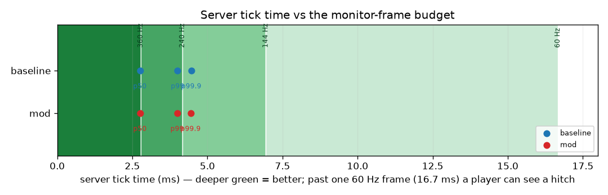
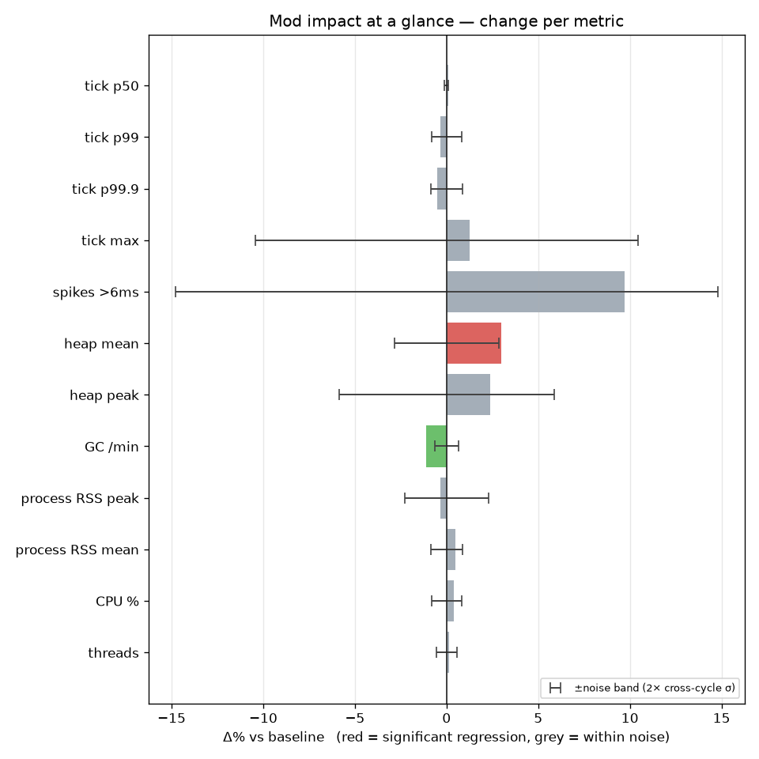
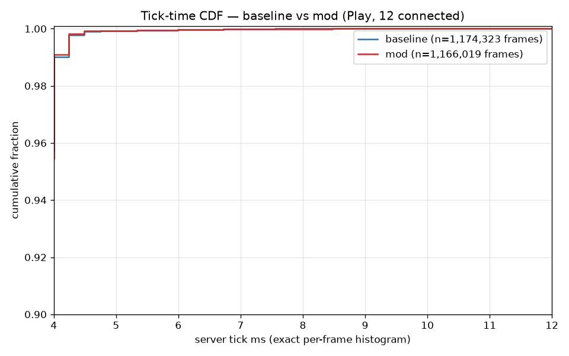
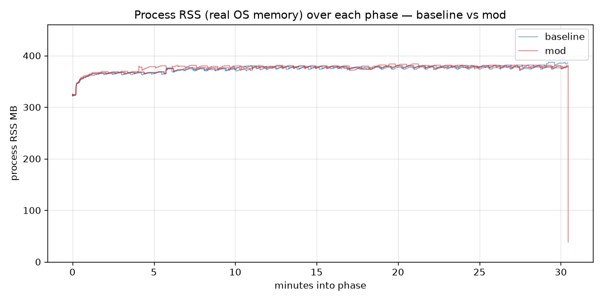

# voice_rate_guard

Stops one client from crashing other Puck clients through voice chat. The
exploit is a crash only.

Built against **Puck B1235**. One DLL for two roles:

- **Server role** (dedicated server): the server does not relay a bad voice
  start or a malformed or excessive voice packet, and it logs each attempt.
- **Player role** (game client or listen host): the game ignores them. A player
  uses this role on servers that do not run the mod.

A server operator needs the mod **on the server only**. Do not force it on
clients: the server role protects every player on that server. Players install
the mod themselves for servers that do not run it.

## Install

Use the Steam Workshop item:
<https://steamcommunity.com/sharedfiles/filedetails/?id=3836490246>

**Server:** add the item to the `mods` list in the server config, then restart
the server. Do not make it client-required.

```json
"mods": [
  { "id": "3836490246", "isEnabled": true, "isClientRequired": false }
]
```

Check the server log for:

```
[voice_rate_guard] enabled v0.3.0 (B1235, server role): voice starts with sampleRate outside 8000-48000 Hz, more than 15 voice starts per second, and malformed or excessive voice packets are not relayed
```

**Player:** subscribe to the item, start Puck and enable `voice_rate_guard` in
the Mods menu. Check `Player.log` for:

```
[voice_rate_guard] enabled v0.3.0 (B1235, player role): voice starts with sampleRate outside 8000-48000 Hz, more than 15 voice starts per second, and malformed or excessive voice packets are ignored
```

### Alternative for servers: turn off voice chat

A server that does not need voice chat can turn it off in `server_config.json`
instead, then restart:

```json
"useVoip": false
```

The server then relays no voice start and no voice packet, so the exploit
cannot reach the players. This also turns off voice chat for all players. The
key is case-sensitive. When the key is not in the file, voice chat is off.

## The problem

The game does not check some voice-chat data that a client sends. Bad data
crashes the other players' games.

## What the mod does

`OnEnable` reads `ApplicationManager.IsDedicatedGameServer` and applies the
Harmony prefixes for that role. Both roles allow 8000–48000 Hz
(`SampleRateRange.cs`) and the voice packet limits in `VoiceDataLimits.cs`.
Normal voice passes through, and nothing is logged.

### Server role: `RelayGuard` on `Client_RequestVoiceStartRpc`

For a value outside the range, the prefix returns `false`. The original method
does not run, so the value is never relayed. The server logs one warning line:

```
[voice_rate_guard] BLOCKED voice start: sampleRate=<value> (allowed 8000-48000) client=168 owner=168 steamId=7656119... name="..."
```

### Player role: `ReceiveGuard` on `Server_VoiceStartRpc`

For a value outside the range, the prefix returns `false`. The original method
does not run. Only that player's voice is lost on this client. On a listen host,
this method also runs in the send stage, so the skip also stops the relay to
every peer. The game logs one warning line:

```
[voice_rate_guard] IGNORED voice start: sampleRate=<value> (allowed 8000-48000) owner=168 steamId=7656119... name="..."
```

### Both roles: voice packets

`DataGuard` on `Client_VoiceDataRpc` (server side) and `ReceiveDataGuard` on
`Server_VoiceDataRpc` (player side) drop a malformed or excessive voice packet:

```
[voice_rate_guard] BLOCKED voice data: reason=rate client=168 owner=168 steamId=7656119... name="..."
[voice_rate_guard] IGNORED voice data: reason=rate owner=168 steamId=7656119... name="..."
```

`reason` is `null`, `empty`, `size:<bytes>`, `repeat`, `rate`, `rate-global`
(server: all players together) or `queue` (player: too much audio waiting).

### Both roles: voice start rate

A person starts voice chat with the talk key, so normal starts are slow. In
both roles a player can start voice at most 15 times per second (45 at once
after a network stall). Stops are never blocked. On a player, a stop for a
player who does not record is skipped (the game would only log it).

```
[voice_rate_guard] BLOCKED voice start: reason=rate client=168 owner=168 steamId=7656119... name="..."
[voice_rate_guard] IGNORED voice start: reason=rate owner=168 steamId=7656119... name="..."
```

In both roles, log lines are limited to one per player every 10 s. The next line
shows how many attempts were not logged in between.

## Why it should not conflict with other mods

- Harmony prefixes only, with their own Harmony id. `OnDisable` removes only
  these patches.
- Normal voice passes through without change.
- No events, config, file or network I/O, or threads.
- If a game update changes a method, the mod logs an error and does not patch.

No other indexed mod patches the voice start methods (checked 2026-11-08).

## Server performance

A stress test compared a dedicated server with the mod and the same server
without it: Puck B1235, tick rate 360, 12 bots in normal play, two 30-minute
runs for each. The mod had **no measurable impact**. Each change is inside the
noise of the test.

| Metric | Without mod | With mod |
|---|--:|--:|
| Server tick, median | 2.753 ms | 2.755 ms |
| Server tick, p99.9 | 4.464 ms | 4.442 ms |
| CPU (one core) | 59.1% | 59.3% |
| Process memory, peak | 383 MB | 382 MB |
| Managed heap, mean | 41.9 MB | 43.1 MB |
| Garbage collections per minute | 26.3 | 26.0 |









## Limits

- The server role protects only the servers that run it. The player role
  protects only the players who installed it.
- It does not kick or ban. Use the logged Steam ID for that.

## Build from source

Developers can build the DLL, or reuse the code in their own mods.

1. Copy the Puck B1235 `Puck_Data/Managed/*.dll` into `libs/B1235/`.
2. Optional: `cp local.targets.example local.targets` and set `<TargetDir>` to a
   local install's `Plugins\voice_rate_guard\`.
3. `dotnet build src/VoiceRateGuard.csproj -c Release`

The output is `bin/B1235/VoiceRateGuard.dll` (about 20 KB). To install it
without the Workshop, copy it to `Plugins/voice_rate_guard/VoiceRateGuard.dll`
in the server or game folder. A dedicated server enables it at start. A player
must enable it in the Mods menu.

## License

Public domain. See [LICENSE](LICENSE) (the Unlicense).
